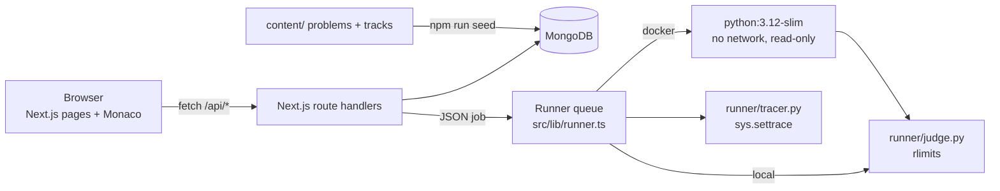

<p align="center"></p>

# CodeCrack — practise like it's the real exam

A full-stack, HackerRank-style coding practice platform built to crack the **Infosys Specialist Programmer (SP) / Digital Specialist Engineer (DSE)** coding assessment, plus HackWithInfy and InfyTQ.

It has a real judge with hidden test cases, a **line-by-line step debugger**, a 12-step Infosys preparation track, timed mock tests with partial scoring, discussions, profiles, a leaderboard, and a community pipeline: anyone can submit a problem, automated checks verify it, and an admin approves it.

> **Stack:** Next.js 15 (App Router, React 19, TypeScript) · MongoDB + Mongoose · Auth.js / next-auth (email + Google + GitHub) · Monaco editor (served locally) · Tailwind CSS 4 · Python judge & tracer · optional Docker sandbox

---

## Table of contents

1. [What you can do](#what-you-can-do)
2. [The question bank](#the-question-bank)
3. [Quick start](#quick-start)
4. [Configuration (.env.local)](#configuration-envlocal)
5. [Roles: learner, contributor, admin](#roles-learner-contributor-admin)
6. [How the judge works](#how-the-judge-works)
7. [How the step debugger works](#how-the-step-debugger-works)
8. [Security model](#security-model)
9. [Hosting it publicly](#hosting-it-publicly)
10. [Adding / editing problems](#adding--editing-problems)
11. [Architecture](#architecture)
12. [Data model](#data-model)
13. [API reference](#api-reference)
14. [Scoring, badges & streaks](#scoring-badges--streaks)
15. [Troubleshooting](#troubleshooting)
16. [Roadmap](#roadmap)

---

## What you can do

### As a learner
| Feature | Details |
|---|---|
| **Coding workspace** | Resizable 3-pane layout (problem · editor · console), stacked on phones. Monaco editor with Python syntax, autocomplete, font size, dark/light theme. Code autosaves to your browser instantly and to the server every 1.5 s. |
| **Run** (`Ctrl+'`) | Runs your code on the sample cases and shows *your output vs expected*, stderr and runtime. With **custom input**, the expected output is computed by the reference solution, like LeetCode. |
| **Submit** (`Ctrl+Enter`) | Judges against every hidden test with time, memory and output limits. Verdicts: **Accepted, Wrong Answer, Time Limit Exceeded, Memory Limit Exceeded, Runtime Error, Output Limit Exceeded, Compilation Error**. On failure you see the failing test's input, your output and the expected output. |
| **Step debugger** | Click the gutter to set breakpoints, then **Debug**. You can step over, into and out, **step backwards**, continue to the next breakpoint (F5/F10/F11), and drag a timeline slider. Panels show variables (changed ones highlighted), the call stack and output so far. **"Debug this failing test"** loads a failing hidden test straight into the debugger. |
| **Hidden help** | Progressive hints, editorial, reference solution and YouTube walkthroughs are **all locked** until you reveal them. Revealing the editorial or solution marks that solve as *assisted* (half points), so your profile stays honest. |
| **YouTube videos** | 259 verified videos (take U forward, Apna College, NeetCode, codestorywithMIK, Pepcoding, Aditya Verma, CodeHelp…) embedded as thumbnails; the player loads only on click. |
| **Prep tracks** | *Crack Infosys SP/DSE*: 12 ordered steps covering all 71 problems, each with a goal, key ideas, exam tips and reading. *Hashing & Prefix-Sum drill*: your practice list. |
| **Mock test** | 3 questions (E/M/H) worth 20/30/50 marks, a 3-hour timer (or 60/90/120 min), **partial marks per test case passed**, like the real exam. |
| **Per-problem stopwatch** | Shows time spent on each problem and turns amber after 40 minutes, a hint to use a hint. |
| **Notes & bookmarks** | Private notes per problem (autosaved) for last-day revision. Bookmark problems and filter by them. |
| **Discussions** | A thread list on every problem plus a community board. Markdown and code blocks, nested replies, upvotes, sort by votes or newest. |
| **Notifications** | A bell icon for replies to your posts and comments, and for review decisions on problems you submitted. |
| **Profile** | Solved by difficulty, a 52-week heatmap, streaks, topic mastery, badges, recent solves, an exam countdown, bio and social links. |
| **Leaderboard** | All time / 30 days / 7 days. |

### As a contributor
Write a problem with statement, samples, hidden tests, a Python reference solution, starter code, hints, editorial and videos.
- **Bulk-add tests:** paste many inputs separated by `---`.
- **Fill expected outputs:** one click runs your reference solution on every input to compute the answers.
- **Submit for review:** automated checks run immediately, so you can fix failures before an admin looks. You're notified when it's approved or changes are requested.

### As an admin
- **Review queue** with automated checks:
  - the reference passes every test, and the samples match
  - at least 5 hidden tests, and the tests are diverse
  - unique title
  - the starter compiles, and doesn't already solve the samples
  - the reference is fast enough
  - test data size is within limits

  **Approve is disabled while any blocking check fails.** You can approve, request changes or reject, with a note to the author.
- **All problems:** hide or publish any problem, or edit it.
- **Discussions:** latest posts and comments; pin or delete from the thread view.
- **Users:** change roles, ban or unban.

---

## The question bank

**71 problems** plus community submissions, each with:

- `solution.py`: a reference solution
- `brute.py`: an obviously-correct brute-force solution
- `gen.py`: a random and edge-case test generator
- `tests.json`: 15–30 generated tests

Every problem is verified by `content/tools/build_tests.py`:
1. The samples are checked against the reference solution.
2. The reference is cross-checked against the **brute force on 300 random small inputs**.
3. The starter code is checked for syntax errors.

All 71 pass.

| Collection | Count | What |
|---|---|---|
| `infosys-sp-dse` | 46 | Patterns reported from Infosys SP/DSE and Power Programmer rounds: greedy, prefix sums, DP (the Hard slot), graphs, trees, Fenwick, KMP, number theory, XOR basis |
| `infosys-easy-medium` | 14 | The Q1/Q2 slot |
| `hackwithinfy` | 9 | HackWithInfy round 1/2 patterns |
| `infytq` | 3 | InfyTQ coding |
| `fundamentals` | 16 | Technique ladder: prefix sum, two pointers, sliding window, greedy, binary search on the answer, recursion, fast power, bits, the 4 classic DPs |
| `hashing-drill` | 9 | Hashing + prefix-sum drill (majority element, frequency sort, equal 0s/1s, permutation check, most common word…) |

**Honesty note:** Infosys doesn't publish its questions. These problems are **original write-ups of patterns candidates reported** on PrepInsta, GeeksforGeeks / Naukri / LeetCode-discuss interview experiences, community GitHub sheets and Codeforces HackWithInfy threads. Nothing is copied from paid or copyrighted sources. Each problem's **Source** line says exactly what it is based on.

**Exam pattern** (from candidate reports, not official): in person and proctored, about 3 hours, traditionally 3 questions (Easy / Medium / Hard), with partial marking per test case. Some recent drives have had 4 questions.

---

## Quick start

Requirements: **Node 20+**, **MongoDB** on `localhost:27017`, **Python 3.10+**, Linux or macOS. Docker is optional, for the sandbox.

```bash
git clone https://github.com/amanjhacodes55/codecrack.git
cd codecrack
cp .env.example .env.local      # then set NEXTAUTH_SECRET:  openssl rand -base64 32
npm install                     # also copies Monaco into public/ (works offline)
npm run seed                    # loads the 71 problems + tracks into MongoDB (~10 s)
npm run dev                     # http://localhost:3000
```

**The first account you create becomes the admin.** You can also list admin emails in `ADMIN_EMAILS`, or run `npm run make-admin -- you@example.com`.

| Script | What it does |
|---|---|
| `npm run dev` | Development server |
| `npm run seed` | Upsert problems + tracks from `content/`. Keeps stats and submissions. |
| `npm run build:tests` | Re-verify all problems and regenerate `tests.json` (a few minutes) |
| `npm run setup` | `build:tests` + `seed` |
| `npm run make-admin -- <email>` | Promote an account |
| `./scripts/host.sh` / `./scripts/host.sh stop` | Publish publicly via ngrok, or stop |

---

## Configuration (.env.local)

| Variable | Default | Meaning |
|---|---|---|
| `MONGODB_URI` | `mongodb://127.0.0.1:27017/codecrack` | Database |
| `NEXTAUTH_URL` | `http://localhost:3000` | Public URL of the site (`scripts/host.sh` sets it automatically) |
| `NEXTAUTH_SECRET` | — | **Required.** `openssl rand -base64 32` |
| `GOOGLE_CLIENT_ID` / `GOOGLE_CLIENT_SECRET` | empty | Shows "Continue with Google" when set |
| `GITHUB_CLIENT_ID` / `GITHUB_CLIENT_SECRET` | empty | Shows "Continue with GitHub" when set |
| `ADMIN_EMAILS` | empty | Comma-separated emails that are always admin |
| `FIRST_USER_ADMIN` | `true` | Set `false` on public deployments so the first sign-up isn't made admin |
| `ENABLED_LANGUAGES` | `python` | `python,cpp,java` (C++ needs g++, Java needs a JDK) |
| `RUNNER_SANDBOX` | `local` | `local` or `docker` (see [Security model](#security-model)) |
| `RUNNER_IMAGE` | `python:3.12-slim` | Image used in docker mode |
| `RUNNER_CONCURRENCY` | `4` | Programs judged in parallel |

### Google sign-in (free)
1. Go to [Google Cloud Console → Credentials](https://console.cloud.google.com/apis/credentials), choose **Create credentials → OAuth client ID → Web application**, and complete the consent screen if asked.
2. Under **Authorised redirect URIs**, add `http://localhost:3000/api/auth/callback/google`, plus `https://<your-public-domain>/api/auth/callback/google` if you host it.
3. Paste the client ID and secret into `.env.local` and restart.

GitHub works the same way: [Developer settings → OAuth Apps](https://github.com/settings/developers) → callback URL `…/api/auth/callback/github`. Accounts with the same email are linked automatically.

---

## Roles: learner, contributor, admin

- **Visitors** can browse problems, statements, tracks, discussions and profiles.
- **Signed-in users** can run, submit and debug, reveal hints and solutions, post and comment, keep notes, take mock tests and contribute problems.
- **Admins** can do everything, plus the review queue, publishing and hiding problems, moderation (pin and delete) and user management.

---

## How the judge works

`runner/judge.py` takes one JSON job on stdin:

```json
{ "language": "python", "code": "...", "tests": [{"input": "...", "output": "..."}], "timeLimitMs": 2000, "memoryMb": 256, "stopOnFirstFail": true }
```

1. It writes the code to a temp directory and compiles it (Python is syntax-checked first, so syntax errors become *Compilation Error*).
2. It runs each test in a new process group with these limits:
   - `RLIMIT_CPU`: time limit + 1 s
   - `RLIMIT_AS`: memory
   - `RLIMIT_FSIZE`: 8 MB of output
   - `RLIMIT_NPROC`: blocks fork bombs and thread bombs
   - a wall-clock kill at 2 × the limit + 1 s
3. It measures CPU time and peak memory with `wait4`, and compares output token-wise per line, ignoring trailing spaces and blank lines.
4. It maps signals and errors to verdicts: `SIGXCPU`/timeout → TLE, `MemoryError` → MLE, `File too large` → OLE, non-zero exit → RE.

Node (`src/lib/runner.ts`) queues jobs (`RUNNER_CONCURRENCY`) and calls the judge either directly (`local`) or inside a throwaway container (`docker`).

## How the step debugger works

`runner/tracer.py` runs your program under `sys.settrace` with your input. It records up to 4000 steps; each step stores:
- the line about to run
- the event (line, call, return or exception)
- the whole call stack with each frame's local variables (repr, type, length)
- how much stdout has been printed so far

The browser receives the full trace, so **stepping backwards is instant**. Step over, out and continue are just searches through the recorded steps by stack depth and breakpoint lines. An infinite loop stops cleanly at the step limit.

## Security model

User code is untrusted.

| Mode | Isolation | Use it when |
|---|---|---|
| `RUNNER_SANDBOX=local` (default) | Process limits (CPU, memory, output, process count), separate process group, clean environment. If the server runs as root (inside the Docker image), user code drops to `nobody`, so it cannot read the server's environment or secrets. | Practising alone on your own machine |
| `RUNNER_SANDBOX=docker` | Every run happens in a fresh `python:3.12-slim` container with **no network**, a **read-only filesystem**, the `nobody` user, 1 GB memory, 1 CPU, 256 PIDs and `no-new-privileges`. About 0.8 s overhead per run. | **Anything public.** `scripts/host.sh` always uses it |

Other protections:
- Rate limits on run, submit, debug, posting and sign-up.
- Markdown is rendered without raw HTML and `javascript:` links are stripped, so there's no XSS.
- Admin APIs check the role on the server.
- Passwords are hashed with bcrypt, and sessions use signed JWT cookies.

## Hosting it publicly

### Option A — from this machine, in one command (free)

```bash
./scripts/host.sh          # builds, starts ngrok + the production server (Docker sandbox), prints the URL
./scripts/host.sh stop
```

- It needs `ngrok` with an auth token (free account) and Docker.
- The URL is written to `.host/url`; logs are in `.host/`.
- The site is up only while this computer is on and connected.
- ngrok's free plan shows a one-time "Visit site" warning page to visitors.

### Option B — Render free tier (always reachable, zero config)

Render → **New → Web Service → Public Git Repository** → `https://github.com/amanjhacodes55/codecrack` → Docker, **Free** instance. Add the environment variables `FIRST_USER_ADMIN=false` and `ADMIN_EMAILS=<your email>`, then deploy.

With no `MONGODB_URI`, the container starts its own password-protected MongoDB. This is **demo mode**: accounts and submissions reset whenever the free instance restarts or sleeps. Problems are re-seeded automatically. For permanent data, create a free MongoDB Atlas cluster and set `MONGODB_URI`. The free instance sleeps after 15 minutes idle, so the first request then takes about a minute.

### Option C — any VPS or Docker host (always on)

```bash
echo "NEXTAUTH_SECRET=$(openssl rand -base64 32)" > .env
echo "NEXTAUTH_URL=https://your-domain" >> .env
docker compose up -d --build         # app + MongoDB; problems are seeded on start
```

Free or cheap places that run Docker containers include Oracle Cloud Always-Free VMs, Google Cloud e2-micro, or any $4–6 VPS. Put Caddy or nginx in front for HTTPS.

> Serverless hosts such as Vercel or Netlify can't run the judge, because it needs to start Python processes.

## Adding / editing problems

Official problems live in `content/problems/<slug>/`. The full format is in [`content/FORMAT.md`](content/FORMAT.md).

```
problem.json   statement, samples, hints, editorial, youtube links, starter code
solution.py    reference solution (stdin → stdout)
brute.py       slow but obviously correct (used for cross-checking)
gen.py         EDGE_CASES, NUM_RANDOM, random_case(rng, i), small_case(rng)
tests.json     generated — never edit by hand
```

```bash
python3 content/tools/build_tests.py content/problems/<slug>   # verify + generate tests
npm run seed                                                    # load into MongoDB
```

Tracks are in `content/tracks/*.json`. The order of problems in the tracks also sets the default order of the problem list.

Community problems are written in the UI (**Contribute**) and stored only in MongoDB.

## Architecture



```
src/app/(site)/          home & dashboard, problems, tracks, mock, discuss, leaderboard, u/[username], settings,
                         submissions, contribute (new/edit), admin (queue, problems, discussions, users)
src/app/(workspace)/     /problems/[slug] — full-screen coding workspace
src/app/api/             REST endpoints (see below)
src/components/          workspace/ (Workspace, CodeEditor, ConsolePanel, DebuggerPanel, tabs, Stopwatch),
                         discuss/, ProblemForm, ReviewPanel, NotificationBell, …
src/lib/                 db, auth, runner, checks, stats, problems, models/
runner/                  judge.py, tracer.py
content/                 problems/, tracks/, tools/build_tests.py, FORMAT.md
scripts/                 seed.ts, make-admin.ts, host.sh, copy-monaco.mjs
```

## Data model

| Collection | Key fields |
|---|---|
| `users` | name, email, username, passwordHash, providers, role (user/admin), banned, bio, college, links, targetExam, targetDate, bookmarks[], revealed[] |
| `problems` | slug, title, difficulty, tags, companies, collections, statement, formats, constraints, samples, hints, editorial*, youtube*, solution*, tests*, starter, timeLimitMs, origin (official/community), status (draft/pending/changes_requested/rejected/approved), author, review notes, checks[], stats |
| `submissions` | user, problem, language, code, verdict, passed/total, timeMs, memoryKb, failed test, assisted |
| `discussions` / `comments` | threads per problem or general; nested comments via `parent`; upvotes, score, pinned, soft delete |
| `notes`, `drafts` | per user and problem (and language, for drafts) |
| `notifications` | user, text, link, read |
| `tracks` | ordered steps → problem slugs, tips, resources |

`*` fields are never sent to the browser unless revealed or requested by an admin.

## API reference

| Method | Path | Auth | Purpose |
|---|---|---|---|
| POST | `/api/register` | — | Create an email/password account |
| GET/POST | `/api/auth/*` | — | next-auth (credentials, Google, GitHub) |
| POST | `/api/run` | user | Run on samples or custom input |
| POST | `/api/submit` | user | Judge against all tests and store the submission |
| POST | `/api/debug` | user | Record an execution trace (Python) |
| GET | `/api/submissions?slug=` · `/api/submissions/:id` | user | Your submissions |
| POST | `/api/problems/:slug/reveal` | user | `{kind: editorial \| solution \| videos}` |
| PUT | `/api/drafts`, `/api/notes` | user | Autosave code / notes |
| POST | `/api/bookmarks` | user | Toggle a bookmark |
| GET/POST | `/api/discussions` | —/user | List / create threads |
| GET/PATCH/DELETE | `/api/discussions/:id` | —/owner/admin | Thread + comments; edit, pin, delete |
| POST | `/api/discussions/:id/vote` · `/comments` | user | Upvote / comment or reply |
| DELETE · POST | `/api/comments/:id` · `/vote` | owner/admin · user | Delete / upvote a comment |
| GET/POST | `/api/notifications` | user | List / mark all read |
| PATCH | `/api/me` | user | Update your profile |
| GET | `/api/mock?slugs=&since=` | user | Best results for mock scoring |
| POST · GET/PUT | `/api/problems` · `/api/problems/:slug` | user / author or admin | Create / read / edit community problems |
| POST | `/api/tools/execute` | user | Run a reference solution on many inputs (authoring) |
| POST | `/api/admin/problems/:id/check` · `/review` | admin | Re-run checks / approve, request changes, reject, unpublish |
| POST | `/api/admin/problems-status` | admin | Hide or publish any problem |
| PATCH | `/api/admin/users` | admin | Role, ban |

## Scoring, badges & streaks

- **Points per first solve:** Easy 10, Medium 25, Hard 50. Assisted solves count half.
- **Streak:** consecutive days with at least one submission.
- **Badges:** First Blood, Getting Serious (10), Grinder (30), Hard Hitter (5 Hard), On Fire (7-day streak), Infosys Ready (75% of the SP/DSE set), No Peeking (10 unassisted solves).

## Troubleshooting

| Problem | Fix |
|---|---|
| "Can't reach the server" toast | The dev server is restarting or down. Run `npm run dev` again. |
| Editor shows "Loading editor…" forever | Run `node scripts/copy-monaco.mjs` (copies Monaco into `public/monaco`) |
| Everything is TLE in docker mode | Check `docker run --rm python:3.12-slim python3 -V` works, and that your user is in the `docker` group |
| Sign-in redirects to the wrong host | Set `NEXTAUTH_URL` to the exact URL you open |
| Edits to an official problem disappeared | `npm run seed` reloads official problems from `content/`. Edit the files there. |

## Roadmap

- C++ and Java starters for every problem (the judge already supports both: set `ENABLED_LANGUAGES`)
- Contest mode with a live leaderboard
- Spaced-repetition reminders for assisted problems
- More companies: TCS NQT, Accenture, Wipro, Cognizant

---

Built for cracking Infosys SP/DSE. Good luck! 🚀
